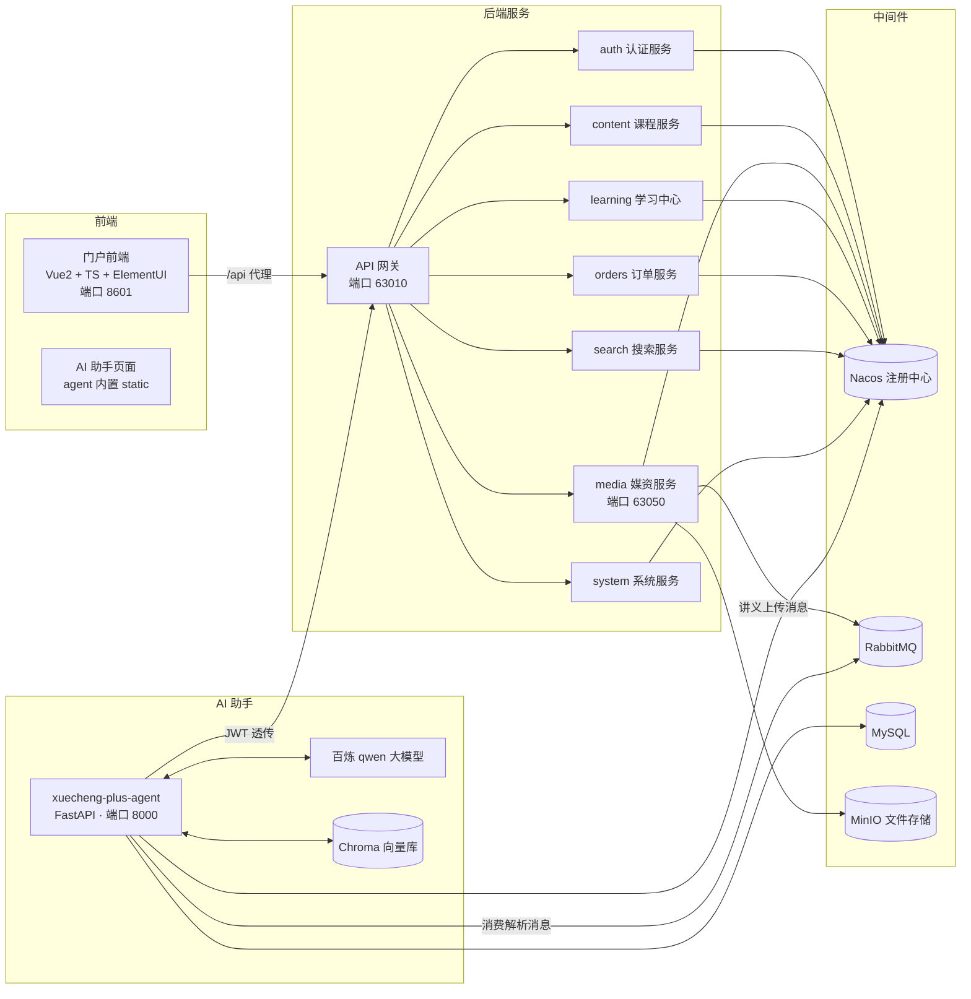
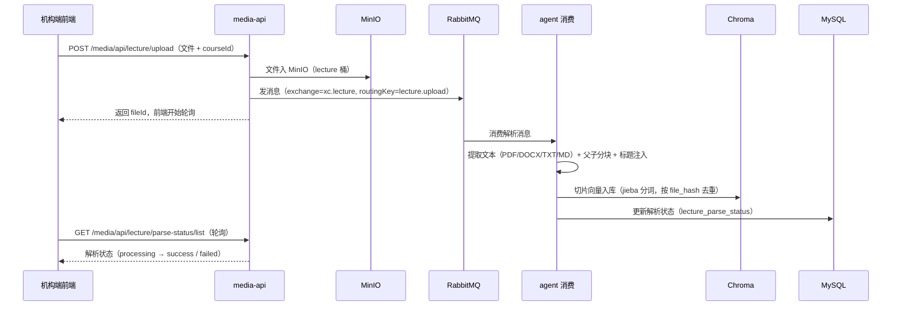
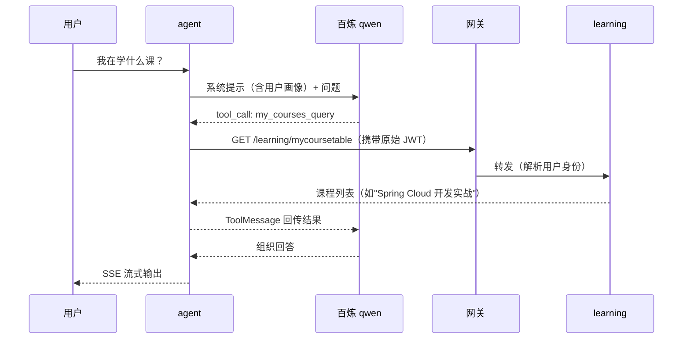

# 学成在线 · 在线教育平台 + AI 学习助手

学成在线（xuecheng-plus）是一个基于 **Spring Cloud 微服务**架构的在线教育平台，覆盖课程内容管理、媒资管理、学习中心、订单等核心业务；在此基础上自研了 **Python AI 学习助手**（`xuecheng-plus-agent`），提供大模型对话、讲义 RAG 知识问答、课程推荐与"我的课程"工具调用等智能能力。

## 项目亮点

- **微服务 + AI 双栈**：Java 微服务作为业务底座，Python Agent 作为智能层，通过网关 + JWT 透传打通两侧
- **讲义智能解析全链路**：机构端上传讲义 → MinIO 存储 + RabbitMQ 消息 → Agent 异步解析 → Chroma 向量入库 → 状态持久化 → 前端轮询
- **高级 RAG 讲义知识问答**：父子分块 + 标题注入入库，向量 / BM25（jieba）双路召回 → RRF 融合 → qwen3-rerank 精排，回答可溯源到课程/页码
- **LLM 工具调用闭环**：Agent 自主决策调用课程推荐、"我的课程"（带 JWT 透传网关）等工具，结果回传后组织回答
- **流式对话 + 记忆管理**：SSE 流式输出；短期会话记忆 + 长期偏好记忆 + 自动压缩

## 架构总览



## 技术栈

| 侧 | 技术 |
| --- | --- |
| Java 后端 | Spring Boot 2.3.7、Spring Cloud Gateway、Nacos、MyBatis-Plus、Lombok |
| Python AI | FastAPI、LangChain 1.x（LangGraph create_agent + astream_events v3）、百炼 qwen（DashScope）、Chroma、pika（RabbitMQ）、MinIO（S3）、PyMySQL、PyJWT |
| 前端 | Vue 2.6 + TypeScript + ElementUI（门户，独立仓库）；原生 HTML/JS（agent 页面） |
| 中间件 | MySQL、Nacos、RabbitMQ、MinIO |

## 目录结构

```
xuecheng-plus-project
├── xuecheng-plus-gateway        # API 网关（路由 / 鉴权 / JWT 校验）
├── xuecheng-plus-auth           # 认证服务（登录签发 JWT，XcUser 用户模型）
├── xuecheng-plus-content        # 课程内容（content-api / content-service）
├── xuecheng-plus-media          # 媒资管理（media-api 63050 / media-service，讲义上传+解析状态）
├── xuecheng-plus-learning       # 学习中心（我的课程 / 选课）
├── xuecheng-plus-orders         # 订单服务
├── xuecheng-plus-search         # 搜索服务
├── xuecheng-plus-system         # 系统服务（数据字典等）
├── xuecheng-plus-checkcode      # 验证码
├── xuecheng-plus-message-sdk    # 消息 SDK
├── xuecheng-plus-base           # 基础模块（公共配置 / 工具）
├── xuecheng-plus-parent         # 父 POM
├── xuecheng-plus-generator      # 代码生成器
├── docs                         # 架构与核心链路文档
└── xuecheng-plus-agent          # AI 学习助手（Python FastAPI，独立 venv）
    ├── app/                     # 源码（auth / agent / rag / memory / tools / routers / static）
    ├── docs/                    # Agent 对接文档 + AI 评测报告（rag-eval-report.md）
    ├── scripts/                 # 运维脚本（一键启动/停止、测试 JWT 生成）+ 完整评测脚本（eval_full.py）
    └── venv/                    # Python 虚拟环境
```

门户前端为独立仓库：`D:\xc\project-xczx2-portal-vue-ts`（Vue2 + TS，端口 8601）。

## 模块说明

| 模块 | 职责 | 端口 / 访问 |
| --- | --- | --- |
| 网关 | 统一入口、路由、JWT 校验 | 63010 |
| auth | 登录、JWT 签发（user_name=XcUserExt） | 经网关 |
| content | 课程 CRUD、课程计划大纲 | 经网关 |
| media | 媒资 / 讲义上传、MinIO 存储、解析状态查询 | 63050（api） / 经网关 |
| learning | 我的课程 / 选课 | 经网关 |
| orders | 订单 | 经网关 |
| system | 数据字典等 | 经网关 |
| agent | AI 对话、RAG 问答、工具调用、讲义消费解析 | 8000 |
| 门户前端 | 门户 + 机构端页面 | 8601 |

## 核心链路

### 链路 1：讲义上传 → AI 解析 → RAG 入库 → 状态轮询



### 链路 2：AI 助手工具调用（我的课程，JWT 透传网关）



### 链路 3：登录认证

门户登录 → auth 服务签发 JWT（payload 携带 `user_name` = XcUserExt JSON）→ 前端存储 token → 请求经网关校验 → agent 解析 `user_name` 获取用户画像（昵称 / 姓名 / ID）并注入系统提示。

## 快速启动

> 以下为 Windows + IDEA 本地开发环境。

**前置依赖**：JDK 8+、IDEA、Python 3.10+、Node 14+、MySQL、Nacos、RabbitMQ、MinIO。

> **数据库初始化**：`sql/` 目录包含全部建表脚本——原工程各库（`xcplus_users` / `xcplus_content` / `xcplus_media` / `xcplus_learning` / `xcplus_orders` / `xcplus_system` / `mq_message*`）+ AI 助手新增表（`sql/xuecheng-plus-agent.sql`：chat_history / user_preferences；`sql/xuecheng-plus-media.sql`：lecture_parse_status）。首次部署按库导入；agent 启动也会自动建其自有表（IF NOT EXISTS）。

1. **中间件**：启动 MySQL / Nacos（8848）/ RabbitMQ / MinIO，配置按 dev 环境（在 Nacos 中维护）。
2. **Java 服务**：IDEA 打开根目录，依次启动基础服务（auth / system）→ 业务服务（content / media / learning / orders / search）→ 网关（gateway）。
3. **AI 助手**（依赖已安装于 venv，首次安装见 `xuecheng-plus-agent/docs`）：

   ```bash
   cd xuecheng-plus-agent
   venv\Scripts\python.exe -m uvicorn app.main:app --host 0.0.0.0 --port 8000
   ```

4. **门户前端**（独立仓库）：

   ```bash
   cd D:\xc\project-xczx2-portal-vue-ts
   npm install
   npm run serve   # 端口 8601，/api 代理到 localhost/api
   ```

5. **访问**：门户 `http://localhost:8601`；AI 助手 `http://localhost:8000`。

## 端口清单

| 服务 | 端口 |
| --- | --- |
| API 网关 | 63010 |
| media-api | 63050 |
| AI 助手（agent） | 8000 |
| 门户前端 | 8601 |
| Nacos | 8848 |
| RabbitMQ | 5672 / 15672 |
| MinIO | 9000 / 9001 |

## 关键设计 & 踩坑记录

- **MQ 发布确认（publisher confirm）**：Spring Boot 2.3.7 无 `setPublisherConfirmType` API，需重写 `RabbitTemplate` Bean；消息可靠性通过 confirm 回调 + 业务状态表兜底。
- **JWT 兼容解析**：门户 JWT 用户身份在 `user_name`（XcUserExt JSON），兼容早期 `sub/user_id/uid/userId`；agent 侧统一解析并提取昵称/姓名注入系统提示，支持"我是谁"等个性化问答。
- **高级 RAG 检索链路**：入库走父子分块（大块 800 / 小块 200，小块入库、检索回传大块）+ 标题注入；检索走向量语义召回（阈值过滤 + embedding 失败降级 BM25-only）+ BM25 关键词召回（jieba + 停用词）→ RRF 融合（k=60）→ qwen3-rerank 精排（失败降级粗排）→ 来源去重（同讲义最多 2 条）；工具层再叠加 LLM 查询改写（对话补全指代）与迭代检索（信息不足换问法再查），`scripts/eval_rag.py` 提供 Recall@K 贯穿评估。
- **v3 事件协议要点**：LangChain 1.x `astream_events(version="v3")` 中，文本增量在 `content-block-delta` 的 `delta.type=="text-delta"`（不是 `"text"`）；工具调用在 `content-block-finish`（结构化 args）；工具结果在 `tools` method 的 `tool-finished`（ToolMessage）——agent 按 `tool_call_id` 反查工具名聚合课程卡片/讲义来源。
- **讲义状态持久化**：解析状态落 MySQL（`lecture_parse_status`），`update_time` 时区统一 Asia/Shanghai，前端可轮询展示"解析中 / 成功 / 失败"。

## 待办（规划中）

- [ ] 自动化测试（agent pytest / Java 单元测试）
- [ ] Docker 化一键部署（中间件 + 服务编排）
- [ ] CI/CD（GitHub Actions：lint + test + build）

## 文档

- [架构与核心链路详解](docs/architecture.md)
