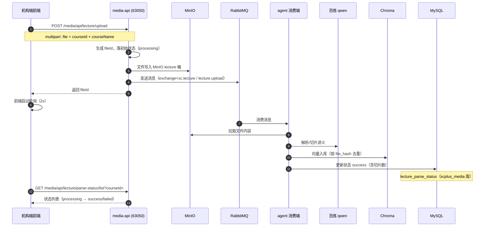
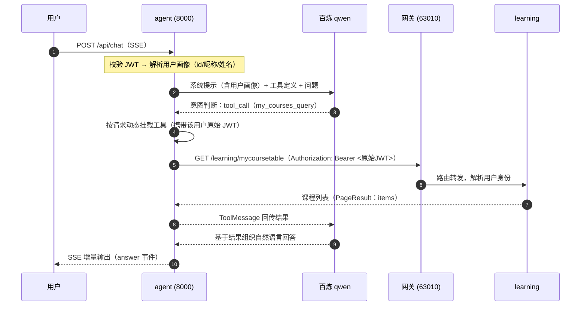
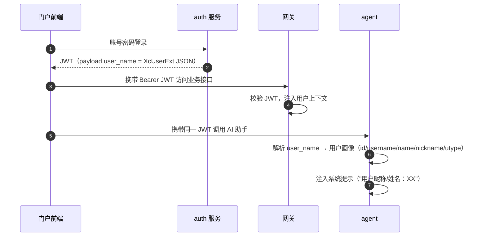

# 架构与核心链路详解

> 本文档是 `xuecheng-plus`（学成在线 + AI 学习助手）的架构细节说明，配套根目录 `README.md` 使用。

## 1. 总体架构

系统分三层：

- **业务层（Java 微服务）**：基于 Spring Cloud，服务注册到 Nacos，统一经 API 网关（63010）对外提供 REST 接口。包括 auth（认证）、content（课程）、media（媒资）、learning（学习中心）、orders（订单）、search（搜索）、system（数据字典）等。
- **智能层（Python Agent）**：独立 FastAPI 服务（8000），集成百炼 qwen 大模型，提供 SSE 流式对话、RAG 讲义问答、工具调用；作为消息消费者处理讲义解析任务，作为 RAG 写入方维护向量库。
- **表现层（前端）**：门户前端（Vue2 + TS + ElementUI，8601，独立仓库）与 agent 内置聊天页面（原生 HTML/JS）。

两层之间的连接方式：

| 通道 | 方向 | 说明 |
| --- | --- | --- |
| HTTP + JWT 透传 | agent → 网关 | agent 携带用户原始 JWT 调用网关，由网关路由到 Java 服务并解析用户身份 |
| RabbitMQ | media → agent | 讲义上传后发消息，agent 消费并解析 |
| HTTP 直连 | 门户 → media-api | 门户机构端直连 63050 上传讲义 / 轮询解析状态（带 JWT） |

## 2. 核心链路时序

### 2.1 讲义上传 → AI 解析 → RAG 入库 → 状态轮询

要点：

- **可靠性**：media 发送消息启用 publisher confirm；agent 侧消费失败不确认会重新投递。
- **幂等**：RAG 入库按 `file_hash` 去重，重复上传同一文件不会重复切片。
- **可观测**：解析状态（processing/success/failed + message + 切片数）持久化到 MySQL，前端轮询展示。

### 2.2 AI 助手工具调用（我的课程，JWT 透传网关）

要点：

- **工具动态挂载**：工具不是全局单例，而是按"请求级 token"动态构造，token 为空则不挂载，避免串号与污染。
- **JWT 透传**：agent 不解密 Java 侧业务接口的完整语义，仅把请求携带的原始 JWT 原样透传给网关，由网关负责身份解析。
- **结果兼容**：工具层兼容 PageResult 的 `records / items / list / data` 多种字段形态，非 200 响应转为可读错误文案回传 LLM。
- **工具参数兼容**：百炼 DashScope 兼容层对单参数工具返回 `__arg1`，工具层用 `_first_str_arg` 做通用键名兜底。

### 2.3 登录认证与用户画像

要点：

- 兼容早期 JWT：`sub / user_id / uid / userId` 直接携带用户 ID 的格式。
- 显示名优先级：`nickname` > `name` > `username`。

## 3. 关键数据模型

### 3.1 用户（xc_user，auth 域）

| 字段 | 说明 |
| --- | --- |
| id / username / password | 主键、登录名、密码（加盐） |
| name / nickname | 姓名 / 昵称（显示名来源） |
| userpic / utype / status | 头像 / 用户类型 / 状态 |

### 3.2 讲义解析状态（lecture_parse_status，xcplus_media 库）

| 字段 | 说明 |
| --- | --- |
| file_id | MinIO 文件 ID（唯一） |
| course_id / course_name | 所属课程 |
| status | processing / success / failed |
| message | 解析结果描述（如"解析成功，切片 N 条"） |
| update_time | 更新时间（Asia/Shanghai） |

### 3.3 会话与偏好（agent 本地库）

- 会话表：记录对话 session、首条消息摘要（历史会话 UI 用）。
- 偏好表：记录用户长期学习偏好（由 SummarizationMiddleware 从对话中提炼写入）。

## 4. 关键设计细节

### 4.1 MQ 发布确认（publisher confirm）

- Spring Boot 2.3.7 的 `RabbitTemplate` 没有 `setPublisherConfirmType` API，需重写 `RabbitTemplate` Bean（`CachingConnectionFactory` + `ConfirmCallback`）。
- 发送后等待 confirm 回调；失败场景由业务状态表（讲义状态 processing/success）兜底，可人工重发。

### 4.2 RAG 检索质量控制

- 召回后按 `rag_max_distance=0.7` 过滤低相似度切片。
- 按 `file_hash` 去重，同一讲义不重复入库。
- 回答标注来源（课程名 / 源文件 / 页码），支持溯源。

### 4.3 会话记忆

- 短期：会话历史（最近 N 轮，存入上下文）。
- 长期：偏好记忆（跨会话，系统提示注入）。
- 压缩：SummarizationMiddleware 在上下文超限时自动压缩历史。

## 5. 踩坑记录

| 问题 | 现象 | 解决 |
| --- | --- | --- |
| Spring Boot 2.3.7 无 `setPublisherConfirmType` | 编译报错 | 重写 `RabbitTemplate` Bean 启用 confirm |
| Chroma 1.5.9 低维向量 | cosine distance 全为 1.0，召回失真 | 加阈值过滤 + file_hash 去重 |
| 百炼工具参数名 `__arg1` | 单参数工具取不到 query | `_first_str_arg` 通用键名兜底 |
| 门户 JWT 无统一 ID 字段 | 早期格式解析失败 | 兼容 sub/user_id/uid/userId + user_name JSON |
| `update_time` 时区偏差 | 入库时间差 8 小时 | 统一 Asia/Shanghai |
| 命令行 Maven 编译 Lombok 报错 | 本机 IDEA 外编译失败 | Java 改动在 IDEA 内编译运行 |

## 6. 扩展指引

- **新增工具**：在 `xuecheng-plus-agent/app/tools.py` 定义工具函数 + schema，并在 `agent.py` 按请求挂载。
- **新增转发路由**：在 `app/routers/` 新增路由，走网关（63010）或直连 Java 服务，JWT 透传。
- **新增业务表**：Java 侧 service 建表 + MyBatis-Plus 实体；agent 侧仅通过 HTTP 访问，不直接依赖表结构。
